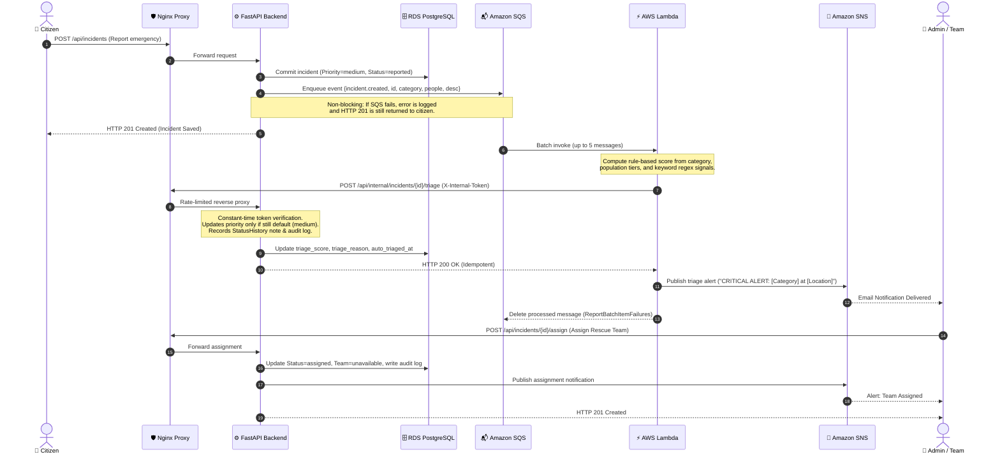

# System Architecture & Technical Diagrams

This document illustrates the structural, network, and event-driven architecture of the **Cloud-Based Intelligent Disaster Management and Emergency Response Platform**.

---

## 1. High-Level System Architecture

The platform combines containerized microservices hosted on Amazon EC2 with a serverless event-driven processing pipeline powered by Amazon SQS, AWS Lambda, and Amazon SNS.

```mermaid
graph TB
    subgraph Clients["Clients & Users"]
        Citizen["👤 Citizen (Reporter)"]
        Admin["👮 Admin / Responders"]
    end

    subgraph AWS_Cloud["AWS Cloud (Region: ap-south-1)"]
        subgraph ComputeLayer["Container Compute (EC2 / Docker)"]
            Nginx["Nginx Reverse Proxy (Port 80)"]
            FastAPI["FastAPI Backend Application"]
            SPA["React Vite SPA Frontend"]
        end

        subgraph StorageLayer["Data & Persistence"]
            RDS[("Amazon RDS PostgreSQL 16<br/>(Private Subnets)")]
            S3Photos[("Amazon S3 Bucket<br/>(Incident Photos)")]
            SecretsMgr["AWS Secrets Manager<br/>(RDS Credentials)"]
            SSM["AWS SSM Parameter Store<br/>(Internal API Token)"]
        end

        subgraph EventDriven["Serverless Event Pipeline"]
            SQSMain[("Amazon SQS Main Queue<br/>(disaster-incidents-queue)")]
            SQSDLQ[("Amazon SQS Dead-Letter Queue<br/>(disaster-incidents-dlq)")]
            Lambda["AWS Lambda Function<br/>(disaster-triage-handler)"]
            SNS["Amazon SNS Topic<br/>(disaster-alerts)"]
        end

        subgraph Management["Governance & Observability"]
            CloudWatch["Amazon CloudWatch<br/>(Logs, Dashboard, Alarms)"]
            CloudTrail["AWS CloudTrail<br/>(Management Events Trail)"]
            S3Audit[("Amazon S3 Bucket<br/>(Audit Logs - 90 Days)")]
            Budgets["AWS Budgets<br/>($5 Monthly Cost Limit)"]
        end
    end

    Citizen -->|HTTP Report + Photo| Nginx
    Admin -->|Dashboard & Triage Review| Nginx
    Nginx --> SPA
    Nginx --> FastAPI

    FastAPI -->|Direct Photo Presigned URL| S3Photos
    FastAPI -->|Read Credentials on Boot| SecretsMgr
    FastAPI -->|Read Auth Token on Boot| SSM
    FastAPI -->|Async Persistence| RDS
    FastAPI -->|Enqueue Event (Non-blocking)| SQSMain

    SQSMain -->|Batch Trigger (Size 5)| Lambda
    SQSMain -.->|MaxReceiveCount=3 Failures| SQSDLQ
    Lambda -->|Read Shared Token| SSM
    Lambda -->|POST /internal/triage| Nginx
    Lambda -->|Publish Priority Alert| SNS
    FastAPI -->|Publish Status/Assignment Alert| SNS

    SNS -->|Email Notification| Admin

    FastAPI -.->|Structured JSON Logs| CloudWatch
    Lambda -.->|JSON Execution Logs| CloudWatch
    CloudWatch -.->|Metric Alarm Notifications| SNS
    CloudTrail -->|Log Management Events| S3Audit
```

---

## 2. VPC Network Segmentation & Security Topology

Amazon RDS is placed in completely private subnets with no route to the Internet Gateway. AWS Lambda runs in managed serverless compute outside the VPC, communicating back to the application via an authenticated, rate-limited public endpoint.

```mermaid
graph TB
    subgraph AWS_Region["AWS Region (ap-south-1)"]
        IGW["Internet Gateway"]

        subgraph VPC["Disaster Response VPC (10.0.0.0/16)"]
            subgraph PublicSubnet["Public Subnet 1 (10.0.1.0/24 - AZ1)"]
                EC2Instance["EC2 Instance (t3.micro)<br/>Elastic IP: Attached<br/>Docker (FastAPI + Nginx)"]
            end

            subgraph PrivateSubnet1["Private Subnet 1 (10.0.10.0/24 - AZ1)"]
                RDSPrimary[("RDS PostgreSQL 16 Primary")]
            end

            subgraph PrivateSubnet2["Private Subnet 2 (10.0.11.0/24 - AZ2)"]
                RDSSubnetGroup["DB Subnet Group Member"]
            end
        end

        subgraph ServerlessOutsideVPC["Serverless Compute & Services (AWS Managed)"]
            LambdaFunc["AWS Lambda Function<br/>(Auto-Triage Consumer)"]
            SQSQueue["Amazon SQS Queue"]
            SNSTopic["Amazon SNS Topic"]
            S3Storage["Amazon S3 Buckets"]
        end
    end

    IGW <-->|Public Internet Traffic| EC2Instance
    EC2Instance -->|TCP 5432 (Internal SG Only)| RDSPrimary
    EC2Instance -->|boto3 API (HTTPS)| SQSQueue
    EC2Instance -->|boto3 API (HTTPS)| SNSTopic
    EC2Instance -->|Presigned URLs (HTTPS)| S3Storage

    SQSQueue -->|Event Source Mapping| LambdaFunc
    LambdaFunc -->|HTTP POST /internal/triage| IGW
    LambdaFunc -->|Publish Alert (HTTPS)| SNSTopic
```

---

## 3. End-to-End Incident Processing Sequence

This sequence diagram details the asynchronous lifecycle of an emergency report from initial submission to auto-triage and dispatch notification.


